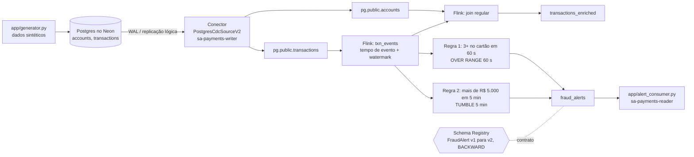

# Pipeline de pagamentos em tempo real no Confluent Cloud

Do `INSERT` no Postgres até o alerta de fraude no consumidor, em segundos.
Os dados nascem num **Postgres (Neon)**, entram no **Confluent Cloud** por **CDC**, são contratados no **Schema Registry**,
processados no **Flink SQL** (enriquecimento + 2 regras de fraude) e lidos por um consumidor com identidade própria de leitura.



| Camada | O que faz | Script | Evidência |
|---|---|---|---|
| 1. Fundação | Ambiente, cluster Basic, Schema Registry, identidade que escreve e identidade que lê | `scripts/01_fundacao.sh` | `evidence/01_fundacao.txt` |
| 2. Contrato | Registra o schema do alerta e testa uma mudança compatível e uma incompatível | `scripts/02_contrato.sh` | `evidence/02_contrato.txt` |
| 3. Ingestão | CDC do Postgres: insert, update e delete chegando como evento | `scripts/03_ingestao.sh` | `evidence/03_ingestao.txt` |
| 4. Processamento | Enriquecimento e regras de fraude no Flink SQL, alerta consumido na ponta | `scripts/04_processamento.sh` | `evidence/04_*.txt` |
| 5. Operação | Métricas, acesso e custo | `scripts/05_operacao.sh` | `evidence/05_*.txt` |

---

## 1. Fundação

**O que faz.** Cria o ambiente `payments-pipeline` com Stream Governance *Essentials* (o Schema Registry vem junto),
um cluster **Basic** e duas *service accounts* com o menor acesso possível:

| Identidade | Pode | Não pode |
|---|---|---|
| `sa-payments-writer` (usada pelo conector) | criar e escrever em `pg.*` e no heartbeat do Debezium | ler ou escrever `fraud_alerts` |
| `sa-payments-reader` (usada pelo consumidor) | ler `fraud_alerts`, usar grupos `fraud-alerts-*` e ler o subject `fraud_alerts-value` | escrever em qualquer lugar, ler `pg.*` |

Se a chave do consumidor vazar, o estrago se limita a alguém **ler alertas**, sem escrever nem ler os dados brutos de pagamento.

**Por quê.** Usei um cluster Basic porque não tem custo fixo e cobra por uso, o que basta para um pipeline de estudo. Separar quem escreve de quem lê é o princípio do menor privilégio aplicado ao Kafka.

**Evidência**

<!-- evid:01_fundacao.txt:80 -->
```text
### Fundação  (2026-11-17 17:06:43 UTC) — criado pelo Console do Confluent Cloud
Organização ......... Bangalô Imóveis (trial, sem cartão; promo code CONFLUENTDEV1)
Ambiente ............ env-v9x3q0 (padrão)
Cluster ............. payments-cluster  lkc-6k61rnq  Basic  AWS us-east-1  status: Executando
Bootstrap ........... pkc-oxqxx9.us-east-1.aws.confluent.cloud:9092

### Service accounts
ID           Nome                 Descrição
sa-gk25yzr   sa-payments-writer   Escreve: conector CDC Postgres -> tópicos pg.*
sa-6onyx58   sa-payments-reader   Le: apenas o topico fraud_alerts
```
<!-- /evid -->

---

## 2. Contrato

**O que faz.** Registra o formato do alerta (`schemas/fraud_alert_v1.avsc`) no subject `fraud_alerts-value` **antes**
de existir qualquer produtor, fixa a compatibilidade em `BACKWARD` e faz dois testes:

| Mudança | Arquivo | Resultado esperado |
|---|---|---|
| Adiciona `severity` **com default** | `fraud_alert_v2.avsc` | ✅ compatível: quem lê com o schema novo ainda entende os dados antigos |
| Troca o tipo de `txn_count` (long → string) e adiciona `risk_score` **sem default** | `fraud_alert_v3_incompativel.avsc` | ❌ recusada pelo registry |

O Flink não cria o tópico `fraud_alerts`. Ele **infere a tabela a partir do contrato registrado** (contract-first).
Assim, um `INSERT` com coluna errada quebra no Flink e não chega ao consumidor.

**Por quê.** Avro + Schema Registry dão contrato tipado e evolução controlada. `BACKWARD` é o modo padrão e o que faz sentido
quando o consumidor atualiza primeiro. A v3 existe para provar que o registry protege o consumidor de uma mudança quebrada.

**Evidência**

<!-- evid:02_contrato.txt:80 -->
```text
### Contrato do alerta — subject fraud_alerts-value  (2026-11-17 17:09:49 UTC)
# Executado no Console do Confluent Cloud (Topics > fraud_alerts > Schema)
Tópico fraud_alerts criado: 1 partição

v1  schemas/fraud_alert_v1.avsc            -> registrada   | schema ID 100001 | versão 1
Modo de compatibilidade do subject: BACKWARD | política: Strict

Teste 1: v3 schemas/fraud_alert_v3_incompativel.avsc (txn_count long->string, risk_score sem default)
  Validar esquema -> "Esquema inválido: A verificação da sintaxe e compatibilidade do esquema falhou."
  Botão Salvar desabilitado: o registry RECUSOU a mudança.

Teste 2: v2 schemas/fraud_alert_v2.avsc (adiciona severity COM default)
  Validar esquema -> "A sintaxe do esquema e a verificação de compatibilidade foram aprovadas."
  Salvo -> schema ID 100002 | versão 2 (atual)
```
<!-- /evid -->

---

## 3. Ingestão (CDC)

**O que faz.** O conector gerenciado **PostgresCdcSourceV2 (Debezium)** lê o WAL do Postgres via slot de replicação lógica
(`payments_slot`, plugin `pgoutput`) e publica cada mudança em `pg.public.accounts` e `pg.public.transactions`, em Avro.

O que o banco precisa **antes** do conector subir (o script confere e salva a saída):

| Pré-requisito | Por quê |
|---|---|
| `wal_level = logical` (no Neon: *Settings > Logical replication*) | sem isso o WAL não tem informação suficiente para decodificar linha a linha |
| Usuário com `REPLICATION` | só ele pode abrir slot de replicação |
| Publicação `payments_pub` com as 2 tabelas | define o que entra no fluxo |
| `REPLICA IDENTITY FULL` | faz `before` vir completo no update/delete |
| Host **direto**, sem `-pooler` | replicação não passa pelo PgBouncer |

Configurações relevantes do conector (`connectors/postgres-cdc.template.json`):
- `after.state.only=false`: mantém o envelope `before/after/op`. É ele que prova insert/update/delete.
- `tombstones.on.delete=false`: o delete já vem como `op=d`. Sem tombstone (valor nulo), o Flink lê o tópico de transações como append sem tropeçar.
- `decimal.handling.mode=double`: o valor chega como `DOUBLE` no Flink. Para detectar fraude está ótimo, mas um ledger exigiria `precise`.
- A senha do banco **não** fica no arquivo versionado: o script preenche o template a partir do `.env` em `.state/` (ignorado pelo Git).

**Por quê CDC e não batch.** Um batch (ex.: `SELECT ... WHERE updated_at > ?` a cada 5 min) atrasa o alerta em minutos, perde
`DELETE` e sobrecarrega o banco com varredura. O CDC lê o log que o Postgres já escreve: latência de segundos, captura
os 3 tipos de operação e quase não pesa na origem.

**Evidência**: pré-requisitos, conector `RUNNING` e os eventos `c`, `u` e `d` da conta demo:

<!-- evid:03_ingestao.txt:120 -->
```text
### Pré-requisitos do banco para CDC  (2026-11-17 16:59:17 UTC)
# Executado no Neon SQL Editor (projeto pipeline-pagamentos-db, AWS us-east-1)
$ SELECT current_setting('wal_level'), rolreplication, tabelas publicadas, count(accounts)
wal_level | pode_replicar | tabelas_publicadas      | contas
logical   | t             | accounts, transactions  | 50

### Conector  — Console do Confluent Cloud
pg-payments-cdc  (PostgresCdcSourceV2, Debezium 3.2.5.Final)  status: RUNNING ("pg-payments-cdc is now running")
kafka.auth.mode=SERVICE_ACCOUNT  kafka.service.account.id=sa-gk25yzr (sa-payments-writer)
ACLs criadas para sa-payments-writer: cluster DESCRIBE | tópicos pg* CREATE, WRITE
output.data.format=AVRO  output.key.format=AVRO  after.state.only=false  tombstones.on.delete=false
slot.name=payments_slot  publication.name=payments_pub  publication.autocreate.mode=disabled
table.include.list=public.accounts,public.transactions  decimal.handling.mode=double  snapshot.mode=initial
Tópicos criados: pg.public.accounts (53 mensagens = 50 do snapshot + 3 da demo), pg.public.transactions

### Demo no Neon SQL Editor (17/11/2026 ~17:39 UTC)
INSERT INTO accounts (...) VALUES ('Conta Demo CDC','standard','Recife','low',2500);   -> INSERT 1
UPDATE accounts SET segment='premium', home_city='Olinda' WHERE holder_name='Conta Demo CDC'; -> UPDATE 1
DELETE FROM accounts WHERE holder_name='Conta Demo CDC';                               -> DELETE 1

### Eventos no tópico pg.public.accounts (Message viewer, filtro "Conta Demo CDC")
offset 50  key {"account_id":51}  op="c"  before=null
  after={"account_id":51,"holder_name":"Conta Demo CDC","segment":"standard","home_city":"Recife","risk_tier":"low","credit_limit":2500}
  source={"connector":"postgresql","db":"neondb","table":"accounts","txId":2055,"lsn":29091216,"ts_ms":1794937143125}
offset 51  key {"account_id":51}  op="u"
  before={"segment":"standard","home_city":"Recife",...}  after={"segment":"premium","home_city":"Olinda",...}
  source={"txId":2056,"lsn":29091520}
offset 52  key {"account_id":51}  op="d"  after=null
  before={"account_id":51,"holder_name":"Conta Demo CDC","segment":"premium","home_city":"Olinda",...}
  source={"txId":2057,"lsn":29091784,"ts_ms":1794937149851}
```
<!-- /evid -->


---

## 4. Processamento (Flink SQL)

Os arquivos em `flink/` rodam na ordem numérica, cada um como um *statement*:

| Arquivo | O que faz |
|---|---|
| `01_alter_accounts.sql` | Lê contas como **changelog** (Debezium → retract): o update de uma conta substitui a versão anterior |
| `02_alter_transactions.sql` | Lê transações como **append** (envelope cru), o que as janelas de tempo exigem |
| `03/04 ... txn_events` | Stream limpo, só `op='c'`, com `event_time` = commit no Postgres e watermark de 5 s |
| `05/06 ... transactions_enriched` | Transação + titular, segmento, cidade de origem e `out_of_home_city` |
| `07_insert_alerta_velocidade.sql` | **Regra 1**: 3+ transações no mesmo cartão em 60 s |
| `08_insert_alerta_valor_alto.sql` | **Regra 2**: soma acima de R$ 5.000 no mesmo cartão em janela de 5 min |

**Decisões e porquês**
- **Contas como dimensão, transações como fato.** Conta muda (update/delete), então vira changelog. Transação aconteceu e não muda, então vira append.
- **Join regular, não temporal.** O temporal join espera a watermark das contas avançar. Como contas quase não mudam, o resultado
  ficaria parado. Com 50 contas o estado do join regular é pequeno. Em produção eu colocaria `sql.state-ttl`.
- **Regra 1 com `OVER ... RANGE 60 s`, não janela fixa.** A janela fixa de 1 min perde a rajada que cruza a virada do minuto
  (2 compras às 10:00:50 e 1 às 10:01:10). O `OVER` olha 60 s para trás a partir de **cada** transação.
  Toda transação a partir da 3ª gera alerta, com `txn_count` mostrando o tamanho da rajada.
- **Tempo de evento = commit no banco** (`source.ts_ms`), e não a hora de chegada no Kafka. Se o conector atrasar, a regra continua certa.
- **Watermark de 5 s e 1 partição.** Com pouco volume, partição ociosa trava a watermark. Uma partição basta para o estudo.
  Por isso o script mantém um fluxo normal rodando: a watermark só anda quando chega evento novo.
- **Duas regras, um tópico.** Ambas escrevem em `fraud_alerts`, diferenciadas por `rule_id` e `severity` (campo que entrou na v2 do contrato).

**Evidência**: statements rodando, a rajada gerada e os alertas lidos pela identidade de **leitura**:

<!-- evid:04_processamento.txt:120 -->
```text
### Statements do Flink — compute pool lfcp-386mxkj (AWS us-east-1), Console > Flink > Statements
Tipo           Status     Arquivo
ALTER TABLE    Completed  flink/01_alter_accounts.sql       (accounts como changelog retract)
ALTER TABLE    Completed  flink/02_alter_transactions.sql   (transactions como append)
CREATE TABLE   Failed     flink/03 1ª versão -> "As colunas-chave devem aparecer no início do schema
                          da tabela; os nomes do DISTRIBUTED BY devem estar na mesma ordem" -> corrigido
CREATE TABLE   Completed  flink/03_create_txn_events.sql    (card_id como 1ª coluna)
INSERT INTO    Running    flink/04_insert_txn_events.sql    (332cb47f)
CREATE TABLE   Completed  flink/05_create_transactions_enriched.sql
INSERT INTO    Running    flink/06_insert_transactions_enriched.sql (dc49eb65)
               avisos: UPSERT_AND_PRIMARY_KEYS_DIFFERENT, HIGH_STATE_OPERATOR_WITHOUT_TTL (join regular sem TTL)
INSERT INTO    Running    flink/07_insert_alerta_velocidade.sql (bc07721c)
INSERT INTO    Running    flink/08_insert_alerta_valor_alto.sql (c9778804)

### Tráfego gerado no Neon SQL Editor (~17:45–17:51 UTC)
fluxo normal aleatório (50 contas x 2 cartões) +
RAJADA     card-0007-1: 4 transações, 8 s entre elas (89,90 | 152,40 | 210,00 | 74,35)
GRANDES    card-0012-1: 3 compras em ~20 s (2.150 | 1.890 | 2.300 = 6.340)

### Tópico fraud_alerts — Message viewer (lido com o schema v2)
offset 0  VEL-9   VELOCITY_3_IN_60S  card-0007-1  conta 7   txn_count=3  total=452.30   severity=HIGH
offset 1  VEL-11  VELOCITY_3_IN_60S  card-0007-1  conta 7   txn_count=4  total=526.65   severity=HIGH
offset 2  VEL-17  VELOCITY_3_IN_60S  card-0012-1  conta 12  txn_count=3  total=6340.00  severity=HIGH
offset 4  AMT-card-0012-1-202611171445  HIGH_AMOUNT_5MIN  card-0012-1  conta 12  txn_count=3  total=6340.00
          window_start=1794937500000 (17:45:00 UTC)  alert_time=1794937799999 (fim da janela)  severity=MEDIUM
(offset 3 = marcador de commit transacional do Flink; "Total messages 5")
Observação: as 3 compras grandes também dispararam a regra 1 (3 em menos de 60 s) — as regras se complementam.
A regra 2 só emite quando a watermark passa do fim da janela (17:50:00 + 5 s): foi preciso tráfego depois das 17:50:05.

### Tópico transactions_enriched — amostra
txn 31  card-0013-1  R$ 283,38  Posto Ipiranga     Recife | Diego Souza      premium   home_city=Fortaleza  out_of_home_city=true
txn 30  card-0038-2  R$ 109,08  Mercado Bom Preço  Recife | Isabela Barbosa  business  home_city=Curitiba   out_of_home_city=true
txn 25  card-0004-1  R$  25,51  iFood              Recife | Elisa Dias       premium   home_city=Salvador   out_of_home_city=true
txn 27  card-0008-2  R$ 251,20  iFood              Recife | Isabela Barbosa  business  home_city=Recife     out_of_home_city=false
```
<!-- /evid -->

Consultas para print no Flink SQL Workspace: `flink/90_consultas_verificacao.sql`.


---

## 5. Operação

**Métricas.** O script consulta a Metrics API (`received_records`, `sent_records`, `received_bytes`, `retained_bytes` por tópico),
o status do conector, dos statements, do compute pool e o lag do consumidor.

**Acesso.** Lista service accounts, ACLs, API keys (sem segredos) e role bindings. Assim dá para conferir que o leitor só lê `fraud_alerts`.

<!-- evid:05_operacao.txt:150 -->
```text
### Saúde dos componentes  (17/11/2026 ~17:53 UTC) — Console do Confluent Cloud
Conector   pg-payments-cdc  lcc-v7wzj8j  Running  Source  PostgresCdcSourceV2  tasks=1  ~12 B/s
Flink      4 statements INSERT Running (txn_events, enriquecimento, regra 1, regra 2) — compute pool lfcp-386mxkj
           enriquecimento: "0 messages behind | 12 per min in | Watermark: Up to Date (saída)"

### Tópicos (Console > Topics)            partições  produção  consumo  retido
pg.public.accounts                           1          0 B/s     –        11.91 KB
pg.public.transactions                       1          19 B/s    19 B/s   6.41 KB
txn_events                                   1          14 B/s    28 B/s   3.50 KB
transactions_enriched                        1          25 B/s    –        3.23 KB
fraud_alerts                                 1          –         –        5 msgs (4 alertas + 1 marcador de commit)

### Acesso: quem pode o quê
sa-payments-writer (sa-gk25yzr): ACL cluster DESCRIBE + tópicos prefixo pg* CREATE, WRITE  (usada pelo conector)
sa-payments-reader (sa-6onyx58): criada SEM nenhuma permissão (nem pg.*, nem fraud_alerts). ACL de leitura + API key ficam para quando o consumidor rodar
Statements do Flink: rodam com a conta do usuário (Heitor) — próximo passo: service account própria
```
<!-- /evid -->

### Quanto custou

<!-- evid:05_custo.txt:60 -->
```text
### Custo (Console > Billing and payment > Rewards), 17/11/2026 ~17:54 UTC
Crédito do trial ............ US$ 400 / US$ 400 restantes (29 dias)
Código CONFLUENTDEV1 ........ US$ 1 / US$ 1 (30 dias) — dispensou o cartão de crédito
Forma de pagamento .......... NENHUMA cadastrada -> fim do trial suspende a org, não cobra
Neon ........................ plano Free (sem cartão)
Gasto real em dinheiro ...... R$ 0,00
Obs.: o billing do Confluent consolida com algumas horas de atraso; o consumo de crédito do dia aparece depois.
```
<!-- /evid -->

| Item | Como foi pago | Custo em dinheiro |
|---|---|---|
| Cluster Basic (1º eCKU grátis + uso) | crédito do trial | R$ 0 |
| Conector PostgresCdcSourceV2 (task-hora + throughput) | crédito do trial | R$ 0 |
| Flink (CFU-minuto, 4 statements) | crédito do trial | R$ 0 |
| Stream Governance Essentials | crédito do trial | R$ 0 |
| Neon (plano Free) | grátis | R$ 0 |
| **Total** | **US$ 400 de crédito, sem cartão cadastrado** | **R$ 0** |

Como ficou de graça: conta nova do Confluent Cloud ganha US$ 400 de crédito por 30 dias, e o código
`CONFLUENTDEV1` na tela de pagamento dispensa o cartão. Sem forma de pagamento, o fim do trial **suspende**
a organização em vez de cobrar. O consumo exato de crédito aparece no Billing algumas horas depois (atraso de consolidação).

O que mais pesa: **conector** e **Flink** cobram pelo tempo ligado, mesmo sem tráfego. Por isso o `99_teardown.sh` existe e foi rodado no fim.
O cluster Basic e o Schema Registry Essentials custam quase nada nesse volume.


---

## Como este pipeline foi montado

Tudo foi montado pelos **consoles web** (Confluent Cloud e Neon), na ordem das camadas, e cada evidência acima veio de lá:
SQL Editor do Neon para o banco e para gerar tráfego, Console do Confluent para cluster, identidades, schema, conector e
Flink SQL Workspace. O Neon foi criado pela integração Neon da Vercel (a conta do Neon é gerenciada pela Vercel).

Os scripts em `scripts/` fazem o mesmo caminho pela Confluent CLI, para quem prefere linha de comando. Eles seguem os
mesmos arquivos (`sql/`, `schemas/`, `connectors/`, `flink/`). Um ajuste descoberto ao subir de verdade já está neles:
no Confluent, a coluna do `DISTRIBUTED BY` precisa ser a **primeira** do schema (`card_id` em `txn_events`).

## Como subir do zero

**Pré-requisitos**
- Conta no [Confluent Cloud](https://confluent.cloud) (conta nova vem com créditos de avaliação) e [Confluent CLI](https://docs.confluent.io/confluent-cli/current/install.html) v4+
- Conta no [Neon](https://neon.tech) (free tier)
- `bash`, `jq`, Python 3.10+. No Windows, use **WSL** ou **Git Bash**

**Passo a passo**

1. **Neon:** crie um projeto na região `AWS us-east-1`, abra *Settings > Logical replication > Enable* e copie a connection string **direta** (sem `-pooler`).
2. **Config local:**
   ```bash
   git clone https://github.com/PRGHeitor/pipeline-pagamentos-confluent.git
   cd pipeline-pagamentos-confluent
   cp .env.example .env      # preencha PG_HOST, PG_USER, PG_PASSWORD...
   ```
3. **Tudo de uma vez:**
   ```bash
   bash scripts/subir_tudo.sh
   ```
   Ou camada por camada, conferindo cada uma antes de seguir:
   ```bash
   bash scripts/00_prereqs.sh
   bash scripts/01_fundacao.sh
   bash scripts/02_contrato.sh     # espere ~1 min após a 01 (API keys propagando)
   bash scripts/03_ingestao.sh
   bash scripts/04_processamento.sh
   bash scripts/05_operacao.sh
   python app/fill_readme.py      # cola as saídas de evidence/ neste README
   ```
4. **Brincar com o pipeline** (com tudo no ar):
   ```bash
   python app/generator.py steady --duration 600          # fluxo normal
   python app/generator.py burst --card card-0003-2       # dispara a regra 1
   python app/generator.py big-spend                      # dispara a regra 2
   python app/alert_consumer.py --duration 0              # escuta para sempre
   ```

Os IDs criados ficam em `.state/ids.env` e as chaves em `.state/secrets.env`. Os dois são ignorados pelo Git, e os scripts podem ser rodados de novo sem duplicar recursos.

## Como derrubar tudo

```bash
bash scripts/99_teardown.sh
```
Ordem: statements do Flink → compute pool → conector → **slot de replicação e publicação no Postgres** → API keys → cluster → service accounts → ambiente.
O slot é o detalhe que mais gente esquece: um slot órfão segura WAL indefinidamente e impede o Neon de dormir.

O teardown deste projeto foi feito no mesmo dia, pela mesma ordem:

<!-- evid:99_teardown.txt:40 -->
```text
### Teardown — 17/11/2026 ~18:05 UTC, pelos consoles (ordem importa)
1. Flink: 9 statements apagados (Actions > Delete statement, confirmação "DELETE")
2. Conector pg-payments-cdc (lcc-v7wzj8j) apagado — antes do slot, porque slot ativo não pode ser removido
3. Neon SQL Editor:
   SELECT pg_drop_replication_slot(slot_name) FROM pg_replication_slots
     WHERE slot_name = 'payments_slot' AND NOT active;          -> 1 linha (slot removido)
   DROP PUBLICATION IF EXISTS payments_pub;                     -> DROP
   SELECT slot_name, slot_type FROM pg_replication_slots;
     wal_proposer_slot  physical   <- internos do Neon, não são do pipeline
     wal_retention_slot physical
   publicações restantes: 0
4. Cluster payments-cluster (lkc-6k61rnq) apagado -> tópicos e API key do leitor vão junto
5. Compute pool Flink AWS.us-east-1.env-v9x3q0.ef42 apagado ("You don't have any compute pools")
6. Service accounts sa-payments-writer e sa-payments-reader apagadas
Sobrou: o ambiente "default" (vazio) e o projeto Neon no plano Free (sem slot, a compute volta a dormir).
```
<!-- /evid -->

## Problemas comuns

| Sintoma | Causa provável |
|---|---|
| Conector `FAILED` com erro de replicação | `wal_level` não é `logical`, ou o host tem `-pooler` |
| Conector falha com `TopicAuthorizationException` | ACL do `sa-payments-writer`: rode `confluent kafka acl list` e compare com a 01 |
| `consume` não mostra nada / `401` | API key recém-criada ainda propagando: espere 1–2 min |
| Alerta não aparece | A watermark só anda com evento novo: deixe o `steady` rodando |
| Regra 2 demora | O alerta só sai quando a janela de 5 min fecha (+5 s de watermark) |

## Próximos passos

- Dead letter queue para eventos com defeito, em vez de deixar o conector parar
- Materializar `transactions_enriched` como tabela Apache Iceberg com **Tableflow**
- Pontuar o risco de cada transação com um modelo de IA dentro do Flink
- Rodar os statements do Flink com uma service account própria, em vez do usuário

## Estrutura

```
app/          gerador, consumidor e utilitários Python
connectors/   config do conector CDC (template, sem segredo)
flink/        statements Flink SQL, na ordem de execução
schemas/      contrato Avro v1, v2 e v3 (incompatível de propósito)
scripts/      uma camada por script + subir_tudo, teardown e checklist
sql/postgres/ schema, seed, publicação e teardown do banco
evidence/     saídas reais dos comandos (gerado pelos scripts, segredos mascarados)
docs/prints/  prints do Console
```
